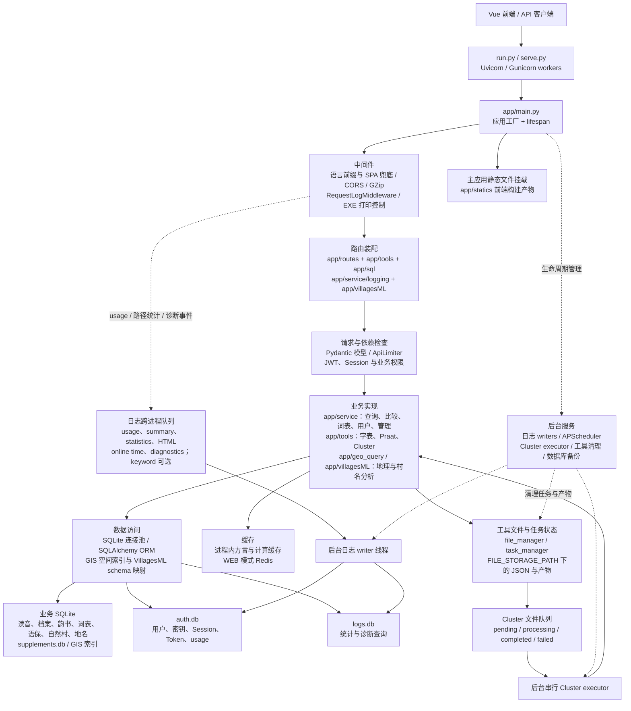

# 方音图鑑 · 后端

[方音图鑑](https://dialects.yzup.top/)的 FastAPI 后端，为汉语方言读音查询、跨地点比较、音系分析、词句资料和地图工作台提供数据与计算服务。

功能介绍依据 Vue 前端中文教程整理；运行方式、配置和接口依据当前后端代码核对。界面交互与绘图由前端完成，后端负责查询、分析、认证、数据管理及工具任务。

- [API 参考与 Schema](api.md)
- [完整 OpenAPI JSON](docs/openapi.json)
- [专题文档索引](docs/README.md)
- [前端仓库](https://github.com/jengzang/dialects-vue-frontend)
- [字表预处理仓库](https://github.com/jengzang/dialects-build)

## 协作入口

如果你准备和当前仓库协作，尤其是准备在 `app/tools/` 目录下新增工具模块、复用文件与任务基础设施、或理解工具模块应当如何统一挂载，请优先阅读：

- [Tools 模块开发与接入指南](docs/implementation/tools/module_development_guide.md)

这份文档已经按当前代码重新整理，重点说明了：

- 如何在 `app/tools/` 下新增一个新的工具模块
- [`app/tools/file_manager.py`](app/tools/file_manager.py) 的每个核心函数如何使用
- [`app/tools/task_manager.py`](app/tools/task_manager.py) 的每个核心函数如何使用
- 工具模块的路由应该在哪里注册
- 为什么所有工具模块现在都应统一在 [`app/tools/__init__.py`](app/tools/__init__.py) 挂载
- `praat` 这类复杂模块在目录结构上可以更复杂，但挂载方式也必须和普通工具一致

如果你是前后端协作者，想快速了解“新增工具模块需要改哪些文件、要配哪些路由、有哪些约束和注意事项”，建议先看这份文档，再动手改代码。

## 功能介绍

### 多方言点查询与比较

查询支持选择多个地点，或按音典分区、地图集分区、行政区划和个人分区筛选地点。地点输入支持模糊匹配与繁简转换。

| 功能 | 用途与结果 |
| --- | --- |
| 查字 | 从汉字出发，查看各地点的 IPA 读音、多音字与注释，并查看读音的地图分布。 |
| 查中古 | 从韵书地位出发，查看所选汉字在各地的声母、韵母或声调。可组合摄、韵、等、呼、清浊、系、组、母、舒入、调、部位、方式等条件，继续细分分类和查看字例。 |
| 查音位 | 从实际音值出发，反查其韵书来源，按选定分类统计字数、占比及对应汉字。 |
| 查调 | 只选择地点或分区，查看各地点的调类、调值及归并情况，也可按调类绘制地图。 |
| 比较汉字 | 比较两个汉字在各地点的声母、韵母或声调异同，地图区分完全相同、部分相同、完全不同及无数据。 |
| 比较中古 | 比较两组韵书条件在同一地点的读音分布重叠程度，每组可以包含多条条件。 |
| 比较调类 | 比较两个调类的调值关系，在地图上观察完全合并、可能合并或不合并的分布。 |
| 音值比较 | 以同一批汉字为锚点，比较 2–5 个地点之间的声母、韵母或声调对应，用桑基图查看连线、节点和具体字例。 |

查询结果可继续打开地点详情、汉字详情和分类统计小窗。部分字表包含文白读标记，可区分文读、白读、文白共用音值及普通多音字。查询的参考体系可切换上古、中古、近古等字集，具体分类字段随所选字表变化，中古广韵资料最为稳定。

### 音系分析

| 功能 | 用途与结果 |
| --- | --- |
| 音系矩阵 | 查询地点的完整声韵调拼合表，点击单元格查看音节字例与文白读标记。 |
| 音素查询 | 自选横向、纵向、格内三个分类维度，重新整理声母、韵母或声调数据。 |
| 音节统计 | 统计音值出现次数、出现地点数及各地点声韵调数量，提供饼图、柱状图和散点图；可选择地点或查看全量统计。 |
| 演化 | 查看单个地点的今音与韵书地位对应，支持按今音追溯来源、按地位观察分化，并用饼图和桑基图查看字例。 |

“演化”展示的是数据中的历史分类与现代音值对应关系，具体解释需要结合材料与语言学分析。

### 词表、语保词句与汉字字集

- **词表展示**：按标准词、方言词、音标、释义、地点或行政区划搜索，以卡片、地图、表格浏览协作者提交的词条。公开浏览无需登录。
- **词表导入与管理**：有编辑权限的用户可以填写地点资料、预览导入文件后提交，编辑自己的词条、批量替换及管理地点资料；管理权限支持查看编辑日志和回滚。导入支持 Excel、文档空格分隔和文档括号识别等格式。
- **语保词句**：查询中国语言资源保护工程的词汇与语法例句，以地图、卡片、表格查看各地点的发音、注释和分区。
- **汉字字集**：按所选韵书的分类层级浏览汉字，调整层级顺序，并查看广韵注释。
- **阳春口语**：查阅本字考、IPA、粤拼、词性、释义、例词例句及待校说明。

### 方言地图与地图工作台

**方言地图**承接查询、比较及分区绘图结果，支持地点详情、地名标签、底图切换和全屏。**分区绘图**可按音典或地图集分区的不同层级着色。**自定地图**可补充个人调查点和特征数据，按地点或特征整理，再绘制地图。

**地图绘制工作台**提供点、线、面、文字图层及属性编辑，支持顶点编辑、吸附、共享边界保护、几何工具、撤销重做和标注排版。可导入 GeoJSON、JSON、KML、KMZ、CSV，以及行政边界和河流水系；可用内置方言点或自有表格生成泰森多边形，再导出到编辑图层。成果支持 GeoJSON 与 PNG 导出。

地图工作台的创建、编辑和导入操作需要登录。本地草稿保存在浏览器中；与账号保存的自定义数据、自定义分区不同，本地草稿不提供跨设备同步。泰森多边形是最近邻划分的示意结果，不能直接视为已证实的方言边界。

### 字表与声学工具

| 工具 | 功能 |
| --- | --- |
| 字表检查 | 上传字表，检查非单字、异常 IPA、缺声调等问题；查看调值与声韵统计，在线修正、批量替换并下载。 |
| 粤拼转 IPA | 上传 Excel，将粤拼转换为 IPA 及声韵调字段；可自定义、导入和导出转换规则。 |
| 字表合并 | 按参考表的汉字顺序对齐多个字表，保留一字多音与注释，下载合并结果。 |
| Praat 声学分析 | 上传或录制音频、选择片段，以单音节或连续语流模式分析基频、强度、共振峰、音质、音段和频谱；基于分析结果查看元音空间与基频定调。 |

这些工具需要登录。Praat 使用 `praat-parselmouth`，音频预处理依赖 FFmpeg；元音空间需要共振峰数据，基频定调需要 pitch 数据。分析任务提交后轮询进度并读取结果，临时文件和结果按工具清理策略保留，应及时下载。

后端还提供方言聚类的任务与分阶段计算接口，可查看任务、距离和聚类结果；具体请求与配置见 [API 参考](api.md)及 [Cluster 专题文档](docs/notes/2026-04-16-cluster-frontend-integration-guide.md)。

### 自然村、村名分析与个人账户

广东自然村资料支持按市、区县、乡镇、行政村、自然村逐级浏览，以及表格搜索、筛选和地图展示。数据来源包括《全粤村情》录入资料，部分记录没有坐标，行政对应和调查信息也可能存在误差。

VillagesML 提供村名搜索、字频、语义、空间、N-gram 模式、区域比较、机器学习计算及系统信息。预计算结果查询与按请求运行的计算模块各有实现，不能将全部接口理解为仅查询离线结果。ML 计算需要登录。详见 [VillagesML 文档](docs/api/villagesml/frontend_guide.md)。

账户支持注册、用户名或邮箱登录、Token 刷新、会话管理、个人统计及排行榜。个人数据和自定义分区与账号绑定，支持不同设备使用；词表编辑权限与登录状态分开管理。管理后台提供用户与权限、数据审核、会话、统计及诊断功能。

## 系统架构

### 架构图

后端由应用工厂装配业务模块。HTTP 请求通过中间件、路由及依赖检查进入业务实现；日志写入和 Cluster 排队任务分别使用独立的后台链路。



图中的依赖检查表示职责，具体先后由 FastAPI 路由和依赖声明决定；并非每条路由都有同一套认证要求。日志队列与 Cluster 文件队列是两套不同机制，普通工具的任务也不都由 Cluster executor 执行。

### 应用装配与模块职责

[app/main.py](app/main.py)的 `_create_app()` 统一设置 lifespan、中间件、路由装配与静态挂载，再由三个工厂选择应用范围：

| 应用工厂 | 路由范围 | 启动流程与配套服务 |
| --- | --- | --- |
| `create_main_app()` | 普通业务、认证、管理、用户、SQL、日志、全部工具、VillagesML，以及当前注册的 GIS 路由 | 使用 `run_main_startup()`；挂载前端静态目录；单进程时由 lifespan 启停后台服务。`create_app()` 与默认 `app` 指向此配置。 |
| `create_gis_app()` | `/api/gis/**` | 使用 `run_gis_startup()`，严格初始化 GIS 引擎；不挂载前端、不由该应用 lifespan 启动后台服务。 |
| `create_cluster_app()` | `/api/tools/cluster/**` | 使用 `run_cluster_startup()`，初始化连接池、清理临时产物和预热方言缓存；不挂载前端、不由该应用 lifespan 启动后台服务。 |

主路由由 [app/routes/__init__.py](app/routes/__init__.py)组织，工具由 [app/tools/__init__.py](app/tools/__init__.py)统一挂载，SQL、日志和 VillagesML 各自提供装配函数。新增模块必须接入相应装配入口，仅定义 `APIRouter` 不会自动成为可访问接口。

[app/schemas/](app/schemas/)及模块内模型定义请求、响应与校验；[app/service/](app/service/)承载主要业务逻辑。Tools、GIS 和 VillagesML 也有自己的计算、数据访问和模型实现，当前并非所有业务都经过统一的 service 抽象。SQLite 连接池主要服务原始 SQL 查询，认证、日志、个人数据和词表还使用 SQLAlchemy；数据库读写权限由认证依赖、数据库选择和业务检查共同控制。

### 启动与关闭流程

主应用的启动步骤在 [app/lifecycle/startup.py](app/lifecycle/startup.py)中顺序执行：

1. 初始化常用业务数据库连接池；当前 admin/user 的档案与读音配置共用文件，不重复预初始化同一路径。
2. `AUTO_MIGRATE` 开启时检查 supplements 用户分区/建议表，以及 logs 统计和诊断表。
3. `AUTO_INDEX` 开启时初始化 SQL 索引。
4. `AUTO_DB_MAINTENANCE` 开启时维护 vocabulary；Gunicorn worker 跳过这一步，由 master 在 fork 前执行。
5. 按工具策略清理过期任务和产物，再预热方言地点缓存。
6. 在主应用单进程模式下启动后台服务；Gunicorn worker 的 lifespan 跳过后台服务启停，由配置钩子管理。

部分 SQLAlchemy 模块在导入时已执行建表或结构检查，因此不能把全部数据库初始化都理解为 lifespan 中的 `AUTO_MIGRATE`。GIS 专用启动流程额外严格加载空间索引；主应用的 GIS 依赖在首次请求时懒加载。

单进程退出时，lifespan 先停止自己启动的后台服务，再关闭 Redis 与 SQLite 连接池。Gunicorn 下，worker 退出清理本进程连接池，master 退出调用后台服务停止逻辑。日志 writer 在限定时间内尝试排空队列，强制终止不能保证所有缓冲记录落盘。

### 后台服务与进程边界

[app/lifecycle/background.py](app/lifecycle/background.py)集中启停以下服务：

| 服务 | 当前实现与职责 |
| --- | --- |
| 日志 writers | 后台线程消费 `multiprocessing.Queue`，分别写入 auth usage/summary/在线时长和 logs 统计/页面访问/诊断。keyword 队列及 writer 受开关控制，默认关闭。 |
| APScheduler | 执行日志、统计及认证相关定时维护任务。 |
| Cluster executor | 单实例串行线程从文件队列领取任务，执行普通聚类及分阶段准备、距离、聚类计算；启动时将遗留 processing 任务重新排队。 |
| 工具清理线程 | 定期调用 `file_manager.cleanup_once()`，按各工具 TTL、清理策略和容量限制处理任务与产物。 |
| 数据库备份线程 | 通过 SQLite backup API 备份 vocabulary、auth、supplements 到 `data/backups/` 下的对应子目录，并清理过期备份。当前 vocabulary 间隔 3 小时，auth/supplements 间隔 24 小时，保留 7 天。 |

使用当前 [gunicorn_config.py](gunicorn_config.py)时，master 的 `on_starting` / `on_exit` 管理后台服务；workers 承接请求，通过共享日志队列和工具文件目录与后台链路协作。多套独立 Gunicorn master 的队列与后台线程不会自动合并，部署拆分时需要明确每套服务的归属。

独立 Cluster 应用的 lifespan 不启动 executor，所以只启动它的 HTTP 服务并不足以执行已入队任务；还需要能够访问同一文件目录的 executor。文件任务状态可供不同 worker 读取，Redis 缓存可跨进程共享，普通进程内缓存则各自独立。

### 日志、统计与缓存边界

- `auth.db` 的 usage 明细、摘要和在线时长服务于用户使用统计、限流及排行榜；`logs.db` 的路径统计、页面访问和诊断用于运维，二者的采集规则不同。
- 诊断默认记录错误与慢请求；仅 MINE 显式启用全量模式时扩大采集。关键词实时采集默认关闭，以减少请求中的参数解析成本。
- WEB 使用 Redis 缓存用户、权限及部分计算结果；MINE/EXE 使用空 Redis 实现。地点匹配与其他模块仍可使用进程内缓存，不代表所有缓存都被关闭。
- 工具任务 JSON、执行队列和结果产物由文件设施管理，不存储在日志队列中，也不是永久业务数据。

## 本地运行

### 环境与数据准备

- 建议使用 Python 3.12，与当前 Docker 基础镜像一致。依赖见 [requirements.txt](requirements.txt)。
- Praat 音频处理需要 FFmpeg；涉及 Numba 的计算需要对应平台的 OpenMP 运行库，Linux 镜像安装 `libgomp1`，macOS 可安装 `libomp`。
- `MINE` / `EXE` 使用空 Redis 实现；`WEB` 使用真实 Redis，需要配置可连接的服务。
- 业务 SQLite 数据库和 `app/statics/` 前端构建产物不随 Git 提交。首次克隆后需另外准备数据；安装 Python 依赖不会生成方言、韵书、语保或自然村的业务数据。

```bash
git clone https://github.com/jengzang/dialects-backend.git
cd dialects-backend
python3.12 -m venv .venv
source .venv/bin/activate
python -m pip install -r requirements.txt
```

Windows 使用 `.venv\Scripts\activate` 激活环境。将所需数据库放到 `data/`，将前端构建产物放到 `app/statics/`（包含 `index.html`）。当前主应用会挂载这个目录，目录缺失时无法完成应用导入。

### 启动开发服务

```bash
python run.py -r MINE -close
```

`MINE` 监听 `0.0.0.0` 并自动重载，首选端口 5000；占用时会寻找后续可用端口。`-close` 禁止自动打开浏览器。按启动输出中的实际端口访问：

- 主页：`http://127.0.0.1:5000/`
- Swagger：`http://127.0.0.1:5000/docs`
- ReDoc：`http://127.0.0.1:5000/redoc`
- OpenAPI：`http://127.0.0.1:5000/openapi.json`

| 模式 | 行为 |
| --- | --- |
| `MINE` | 本地开发，开放 Swagger/ReDoc，禁用真实 Redis，`run.py` 自动重载。 |
| `EXE` | 本地单进程运行，监听 `127.0.0.1`，开放 Swagger/ReDoc，不自动重载。可用 `python run.py -r EXE -close`。 |
| `WEB` | 部署模式，启用真实 Redis，关闭 Swagger/ReDoc 页面，CORS 限定线上域名。通过 Gunicorn/`serve.py` 启动。 |

`run.py` 的参数默认值虽然是 `WEB`，其启动分支目前只处理 `MINE` 和 `EXE`，所以开发时必须显式指定模式；生产使用下面的入口。

## 配置与部署

实际运行模式环境变量是 **`_RUN_TYPE`**。项目没有自动读取 `.env` 的逻辑，配置需由 shell、容器或进程管理器注入。常用配置如下：

| 变量 | 默认值 | 作用 |
| --- | --- | --- |
| `_RUN_TYPE` | `WEB` | 运行模式。`run.py -r` 会设置它。 |
| `REDIS_HOST` | `172.28.199.1` | WEB 模式 Redis 地址；本地部署应显式设置。 |
| `REDIS_PORT` / `REDIS_DB` | `6379` / `0` | WEB 模式 Redis 端口与数据库编号。 |
| `AUTO_MIGRATE` | `false` | 启动时检查/迁移 supplements 与 logs 的相关表；Docker 默认开启。 |
| `AUTO_INDEX` | `false` | 启动时初始化 SQL 索引。 |
| `AUTO_DB_MAINTENANCE` | `true` | vocabulary 启动维护：按需 VACUUM、ANALYZE；Gunicorn 下由 master 执行。 |
| `FILE_STORAGE_PATH` | 系统临时目录下的 `fastapi_tools` | 工具文件、任务与产物存储根目录。 |
| `GIS_DATA_DIR` | `data/dependency` | GIS 数据目录，索引文件为 `gis.db`。 |
| `GEO_AUTO_BUILD_ON_STARTUP` | `1` | GIS 启动流程在缺少索引时尝试构建。 |
| `SECRET_KEY` | 无固定环境默认值 | JWT 密钥优先从数据库读取；此变量仅作为读取失败时的回退。 |

JWT 算法与有效期等常量见 [auth_config.py](app/common/auth_config.py)，限流和路径规则见 [api_config.py](app/common/api_config.py)。Redis 客户端当前读取 host/port/db，没有读取 `REDIS_PASSWORD`。`ALGORITHM`、Token 有效期也不是环境变量覆盖项。

### Gunicorn

从项目根目录启动：

```bash
_RUN_TYPE=WEB REDIS_HOST=127.0.0.1 gunicorn -c gunicorn_config.py serve:app
```

当前提交的 [gunicorn_config.py](gunicorn_config.py)绑定 `0.0.0.0:5000`，使用 3 个 Uvicorn workers，超时 300 秒。master 管理日志写入与调度服务，worker 管理各自数据库等资源。

主应用目前注册普通业务、GIS 和 Cluster 路由。仓库保留了 [GIS](app/entrypoints/gis_app.py)与 [Cluster](app/entrypoints/cluster_app.py)独立入口，但没有 `gunicorn_main.py`、`gunicorn_gis.py`、`gunicorn_cluster.py` 三套配置。若采用独立进程部署，需自行配置端口、worker 生命周期、共享任务存储及反向代理分流，不能直接照搬旧 README 的三进程命令。

主应用启动流程没有预热 GIS 引擎，首次 GIS 请求通过依赖懒加载；专用 GIS 入口则在启动时执行严格初始化。使用前应准备索引并检查状态，路由存在不等于资源齐全。GIS 资源说明见 [scripts/geo/README.md](scripts/geo/README.md)。

### Docker

[Dockerfile](Dockerfile)安装 Python 依赖、FFmpeg 与 OpenMP，默认运行 `gunicorn -c gunicorn_config.py serve:app`。需要挂载业务数据和前端产物，并确保容器用户有写入权限：

```bash
docker build -t dialects-backend:local .
docker run -d --name dialects-backend -p 5000:5000 \
  -e REDIS_HOST=host.docker.internal \
  -v "$PWD/data:/app/data" \
  -v "$PWD/logs:/app/logs" \
  -v "$PWD/app/statics:/app/app/statics" \
  dialects-backend:local
```

此例使用 Docker Desktop 的宿主机 Redis 地址；其他部署需替换为实际可达地址。容器内的 `127.0.0.1` 指向容器本身。数据目录挂载后会覆盖镜像中的 `data/dependency/`，宿主机也要准备所需依赖资源。构建与服务器操作记录见 [HowToBuild.txt](HowToBuild.txt)，其中旧的三进程部署片段需要按现行入口核对。

## 数据与代码结构

数据库路径由 [path.py](app/common/path.py)集中定义。业务库需要从数据构建流程或已有部署获取；自动建表/迁移不等于导入业务数据。

| 数据文件 | 职责 |
| --- | --- |
| `data/query_user.db` / `data/dialects_user.db` | 地点档案、调类资料及方言读音；当前 admin/user 配置均指向这两个文件，访问权限另行控制。 |
| `data/characters.db` | 韵书地位、汉字及注释等字集资料。 |
| `data/vocabulary.db` | 协作词表、地点信息与编辑记录。 |
| `data/yubao.db` / `data/yc_spoken.db` | 语保词句、阳春口语。 |
| `data/villages.db` / `data/villages_admin.db` | 自然村与村名分析资料、管理侧数据。 |
| `data/toponyms.db` | 地名相关业务数据。 |
| `data/supplements.db` | 个人补充数据、自定义分区、提交与建议等。 |
| `data/auth.db` | 用户、密钥、会话、Token 与 API 使用记录。 |
| `data/logs.db` | 访问统计、页面访问、诊断及关键词等日志表。 |
| `data/dependency/gis.db` | 行政边界空间查询索引。 |

```text
run.py / serve.py           本地启动 / Gunicorn 与 Docker 入口
app/main.py                应用工厂、中间件、静态文件挂载
app/routes/                查询、地理、词表、用户与管理路由
app/schemas/               请求与响应模型
app/service/               业务、认证、日志与数据服务
app/lifecycle/             启动、后台服务与资源释放
app/sql/                   通用数据库查询及权限控制
app/tools/                 字表、Praat、Cluster 与文件/任务基础设施
app/geo_query/             GIS 查询引擎
app/villagesML/            村名分析查询与计算
data/                      业务数据库与依赖资源
app/statics/               前端构建产物（不提交）
docs/                      专题说明、OpenAPI 与历史归档
tests/ / StressTest/       回归测试、接口 smoke 与压测
```

## 开发、验证与排障

新增或修改接口时，先确认 [路由装配](app/routes/__init__.py)、请求/响应模型、认证和数据权限，再同步接口文档。工具统一在 [app/tools/__init__.py](app/tools/__init__.py)挂载，文件与任务设施使用方式见 [Tools 开发指南](docs/implementation/tools/module_development_guide.md)。

```bash
# 按实际注册的路由重新生成 api.md 与 docs/openapi.json
python scripts/export_api_docs.py

# 回归测试（需安装 pytest，并满足对应测试的依赖）
python -m pytest tests
```

接口 smoke 配置与使用说明见 [StressTest/smoke/README.md](StressTest/smoke/README.md)。验证涉及写入的接口应使用测试数据副本。

常见排查入口：

- **启动失败或查询为空**：检查工作目录、`app/statics/`、数据库文件及业务表是否齐全，不要用空 SQLite 文件替代真实数据。
- **Swagger 404**：确认使用 `MINE` / `EXE` 和实际监听端口；WEB 模式关闭文档页面。
- **Redis 连接失败**：检查 WEB 模式下的 Redis 地址与容器网络；MINE/EXE 不启用真实 Redis。
- **GIS 不可用**：检查引擎状态、`gis.db` 和实际启动入口；主应用按请求懒加载，专用入口在启动时初始化。
- **查询慢或异常**：查看 [诊断配置](app/service/logging/config/diagnostics.py)及 `logs.db` 的诊断事件。默认只记录错误和超过 10 秒的慢请求，全量诊断只在 MINE 显式开启。
- **排行榜/使用统计异常**：`auth.db` 的 usage 用于用户使用统计，`logs.db` 的诊断与路径访问统计承担不同职责；先核对 [路径规则](app/common/api_config.py)。
- **工具结果过期**：检查 [工具清理策略](app/tools/config.py)与任务状态；临时产物不是长期数据存储。

## 文档维护

README 负责功能概览、运行前提、配置和接手入口；[api.md](api.md)负责当前接口与 schema；[docs/README.md](docs/README.md)导航专题文档；`docs/archive/` 保留历史资料。

功能介绍的核对来源是前端 `project/src/main/components/tutorial/content/zh-CN/` 与 `tutorialManifest.js`，功能变化时应先同步教程，再更新概览。接口变化后重新生成 API 参考。未在 OpenAPI 声明的响应结构、运行时校验和权限分支，仍需阅读路由与服务实现。

本次重写前的 README 保存在 [历史归档](docs/archive/root/readme-before-2026-10-13.md)，仅供追溯，其中旧功能说明、API、统计数字和部署命令不作为现行依据。
